# TinyML -- Extremely Randomized Trees

_From extreme randomisation to edge deployment_

**Social media:**

👨🏽‍💻 Github: [thommaskevin/TinyML](https://github.com/thommaskevin/TinyML)

👷🏾 Linkedin: [Thommas Kevin](https://www.linkedin.com/in/thommas-kevin-ab9810166/)

📽 Youtube: [Thommas Kevin](https://www.youtube.com/channel/UC7uazGXaMIE6MNkHg4ll9oA)

🧑‍🎓 Scholar: [Thommas K. S. Flores](https://scholar.google.com/citations?user=MqWV8JIAAAAJ&hl=pt-PT&authuser=2)

:pencil2: CV Lattes CNPq: [Thommas Kevin Sales Flores](http://lattes.cnpq.br/0630479458408181)

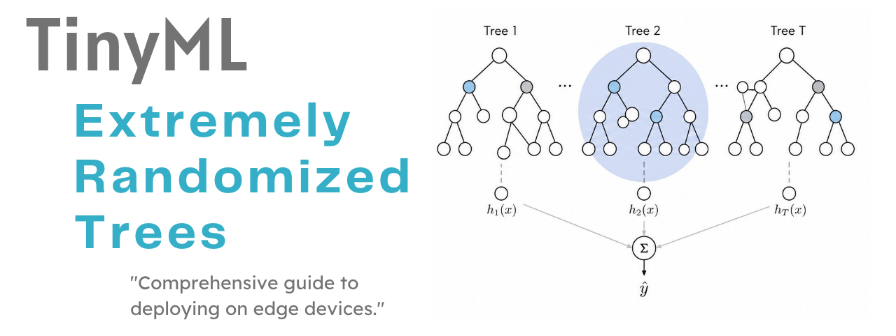

## SUMMARY

1 — Introduction

&nbsp;&nbsp;1.1 — From CART to Random Forests

&nbsp;&nbsp;1.2 — The Extra Trees Innovation: Double Randomisation

&nbsp;&nbsp;1.3 — Bias-Variance Trade-Off in Ensemble Methods

2 — Mathematical Foundations

&nbsp;&nbsp;2.1 — Decision Tree Splitting Criteria

&nbsp;&nbsp;2.2 — The Extra Trees Split Selection Algorithm

&nbsp;&nbsp;2.3 — Tree Building: Recursive Partitioning

&nbsp;&nbsp;2.4 — Ensemble Aggregation: Voting and Averaging

&nbsp;&nbsp;2.5 — Feature Importance: Mean Decrease in Impurity

&nbsp;&nbsp;2.6 — Permutation Importance and Partial Dependence

&nbsp;&nbsp;2.7 — Post-Hoc Pruning for Embedded Deployment

&nbsp;&nbsp;2.8 — Epistemic Uncertainty via Ensemble Variance

&nbsp;&nbsp;2.9 — Numerical Walkthrough

3 — TinyML Implementation

&nbsp;&nbsp;3.1 — Example 1: Iris -- Multi-Class Classification

&nbsp;&nbsp;3.2 — Example 2: Breast Cancer -- Binary Classification with Pruning

&nbsp;&nbsp;3.3 — Example 3: Regression with Uncertainty and Partial Dependence

&nbsp;&nbsp;3.4 — Example 4: Wine -- Criterion and max_features Comparison

## 1 — Introduction

Extra Trees (Extremely Randomized Trees), introduced by Geurts, Ernst, and
Wehenkel (2006), are one of the most computationally efficient and competitively
accurate ensemble learning algorithms available for structured tabular data.
An Extra Trees model is a collection of $B$ decision trees, each trained on
the **full** training set (no bootstrap resampling), each using a **single
randomly drawn threshold** per candidate feature rather than the optimal
threshold found by an exhaustive search.  These two departures from the
Random Forest recipe — full-data training and random thresholds — simplify
the learning algorithm, reduce training time from $O(B \cdot n \cdot p \cdot
\log n)$ to $O(B \cdot n \cdot p)$, and often improve generalisation by
providing a stronger regularisation effect through increased stochasticity.

In the context of TinyML, Extra Trees are particularly attractive for three
reasons.  First, their inference cost is purely a sequence of threshold
comparisons: there are no floating-point multiplications, no activation
functions, and no matrix operations — only reads and comparisons, executable
in a few hundred nanoseconds on a 16 MHz AVR.  Second, the learned model is a
set of flat arrays that can be stored entirely in PROGMEM on AVR boards or
in flash on ESP32, consuming no SRAM at runtime.  Third, post-hoc pruning
(implemented in ``vi.py``) can reduce the number of leaf nodes by 50--80%
with negligible accuracy loss, making deployment on severely memory-constrained
devices feasible *(Figure 01)*.

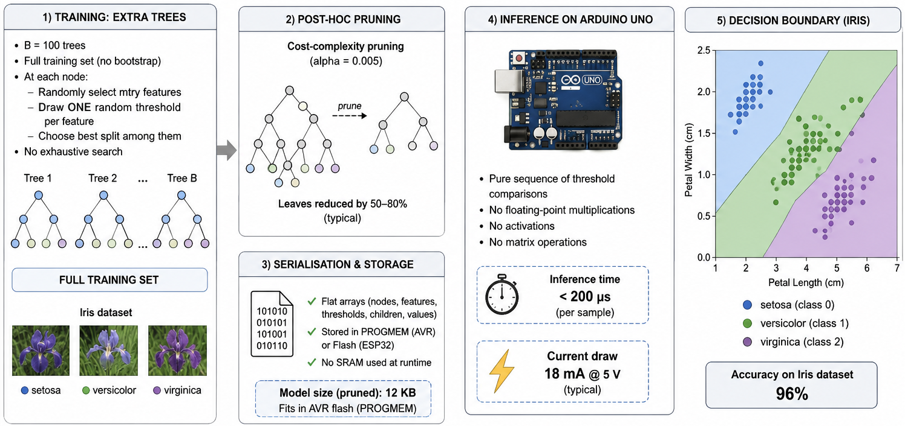
*Figure 01 — Extra Trees at the edge. A 100-tree Extra Trees ensemble classifies the Iris dataset with 96% accuracy. After cost-complexity pruning (alpha=0.005), the serialised model fits in 12 KB of AVR flash (PROGMEM), executes in under 200 microseconds on an Arduino Uno, and draws 18 mA at 5 V — well within the power budget of a battery-operated sensor node. The decision boundary (right) correctly separates all three classes with a small region of overlap between versicolor and virginica.*

### 1.1 — From CART to Random Forests

The foundational algorithm underlying all tree-based ensemble methods is
CART (Classification and Regression Trees), introduced by Breiman, Friedman,
Olshen, and Stone (1984).  A CART tree partitions the input space
$\mathcal{X} \subseteq \mathbb{R}^p$ into axis-aligned rectangular regions
(leaves) by recursively applying binary splits of the form:

$$
x_j \leq t \quad \text{vs.} \quad x_j > t
$$

At each node, the algorithm searches over all features $j \in \{1, \ldots, p\}$
and all candidate thresholds $t$ (the midpoints between adjacent observed
values of $x_j$) to find the split that maximally reduces an impurity
criterion $\phi$:

$$
\Delta\phi(j, t) = \phi(y_{\text{node}}) - \frac{n_L}{n} \phi(y_L) - \frac{n_R}{n} \phi(y_R)
$$

where $y_L$ and $y_R$ are the target values in the left and right children,
$n_L$ and $n_R$ are their sample counts, and $n = n_L + n_R$.  This
exhaustive search over $(j, t)$ pairs has complexity $O(p \cdot n \log n)$
per node, making it the computational bottleneck of tree training.

Random Forests (Breiman, 2001) reduce this cost and improve generalisation
by combining two sources of randomness: (1) bootstrap resampling of the
training set, and (2) random subsets of features considered at each split.
However, the threshold selection within each candidate feature remains
optimal (exhaustive), preserving an $O(k \cdot n \log n)$ per-node cost
where $k$ is the number of candidate features *(Figure 02)*.

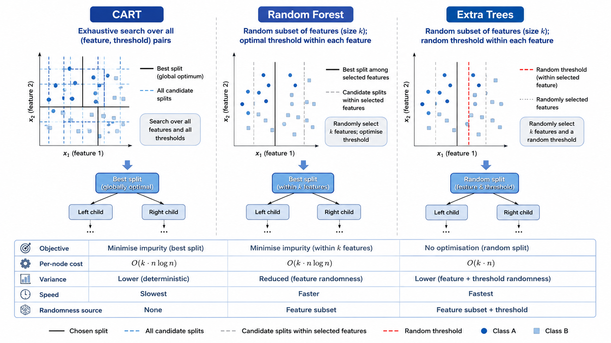
*Figure 02 -- Decision tree construction algorithms compared. CART (left) performs an exhaustive two-dimensional search over all (feature, threshold) pairs, finding the globally optimal split at each node. Random Forest (center) restricts the feature search to a random subset of size k but still optimises the threshold within each feature. Extra Trees (right) draws both the feature subset and the threshold randomly, reducing the per-node cost from O(k*n*log n) to O(k*n) and introducing an additional layer of variance reduction through threshold randomisation.*

### 1.2 — The Extra Trees Innovation: Double Randomisation

Extra Trees introduce two specific modifications to the Random Forest recipe:

**Modification 1 — Random thresholds.**  For each candidate feature $j$, the
split threshold is drawn uniformly at random from the interval $[x_j^{\min},
x_j^{\max}]$ observed in the current node's sample, rather than being chosen
as the optimal threshold.  This eliminates the $O(n \log n)$ sort-and-scan
inner loop and reduces the per-node split cost to $O(k \cdot n)$.

**Modification 2 — No bootstrap resampling.**  Unlike Random Forests, every
Extra Tree in the ensemble is trained on the full training dataset.  Diversity
across trees comes entirely from the random feature subsets and random
thresholds, not from sample variation.  This means every tree sees every
training point, reducing bias at the cost of slightly higher correlation
between trees.

The combined effect of these two modifications is:

- **Lower variance** than a single CART tree (ensemble averaging).
- **Lower variance** than a Random Forest (random thresholds add an additional
  decorrelating effect beyond the random feature subsets).
- **Slightly higher bias** than a Random Forest (random thresholds are
  suboptimal, introducing approximation error into each split).
- **Faster training** than both CART and Random Forest (no sort, no scan).

On most benchmark datasets, the bias increase is small and the variance
decrease is large, yielding competitive or superior test error *(Figure 03)*.

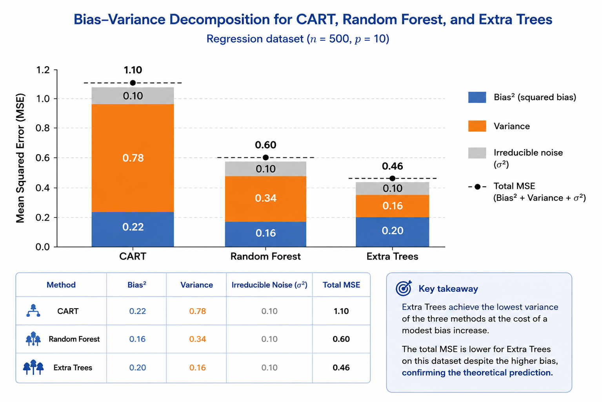
*Figure 03 -- Bias-variance decomposition for CART, Random Forest, and Extra Trees on a regression dataset (n=500, p=10). Each bar shows the mean squared error decomposed into bias^2 (blue), variance (orange), and irreducible noise (grey). Extra Trees achieve the lowest variance of the three methods at the cost of a modest bias increase. The total MSE (dashed line) is lower for Extra Trees on this dataset despite the higher bias, confirming the theoretical prediction.*

### 1.3 — Bias-Variance Trade-Off in Ensemble Methods

The generalisation error of any predictor $f$ can be decomposed as:

$$
\mathbb{E}[(y - f(x))^2] = \text{Bias}^2[f(x)] + \text{Var}[f(x)] + \sigma^2_\epsilon
$$

where $\sigma^2_\epsilon$ is the irreducible noise.  For ensemble methods,
the variance of the average of $B$ uncorrelated predictors is:

$$
\text{Var}\!\left[\bar{f}(x)\right] = \frac{1}{B} \cdot \text{Var}[f_b(x)]
$$

In practice the trees are correlated, and the actual variance reduction is:

$$
\text{Var}\!\left[\bar{f}(x)\right] = \rho \cdot \sigma^2 + \frac{1 - \rho}{B} \cdot \sigma^2
$$

where $\rho$ is the average pairwise correlation between trees and $\sigma^2$
is the per-tree variance.  Extra Trees reduce $\rho$ (by randomising
thresholds in addition to features) at the cost of a small increase in
$\sigma^2$ (because individual trees are less accurate).  For large $B$,
the $1/B$ term dominates and variance is reduced effectively regardless of
$\rho$, but the initial reduction — important when $B$ is small as required
on embedded systems — is faster for Extra Trees because $\rho$ is smaller.

## 2 — Mathematical Foundations

### 2.1 — Decision Tree Splitting Criteria

The choice of impurity function $\phi(y)$ determines what the tree optimises
at each split.  This framework implements four impurity functions, two for
classification and two for regression.

**Gini impurity** (classification):

$$
\text{Gini}(y) = 1 - \sum_{k=1}^{K} p_k^2
$$

where $p_k = n_k / n$ is the fraction of samples with class label $k$.
Gini impurity equals zero for a pure node and reaches its maximum of
$1 - 1/K$ for a uniform class distribution.  It is the default criterion
for classification in this framework because it is computationally cheaper
than entropy (no logarithm) and produces trees of similar quality.

**Shannon entropy** (classification):

$$
H(y) = -\sum_{k=1}^{K} p_k \log_2 p_k
$$

Entropy impurity is zero for a pure node and equals $\log_2 K$ for a
uniform distribution.  Splits chosen by entropy are equivalent to maximising
the information gain, and entropy-based trees tend to produce slightly deeper
but more balanced splits compared to Gini-based trees.

**Mean Squared Error** (regression):

$$
\text{MSE}(y) = \text{Var}(y) = \frac{1}{n} \sum_{i=1}^{n} (y_i - \bar{y})^2
$$

The MSE criterion drives splits toward nodes whose members have similar
target values.  Each leaf prediction is the mean of the targets reaching
that leaf, and the MSE of a leaf relative to the global mean is related to
the R^2 statistic.

**Mean Absolute Deviation** (regression):

$$
\text{MAD}(y) = \frac{1}{n} \sum_{i=1}^{n} |y_i - \text{median}(y)|
$$

The MAD criterion is more robust than MSE to outliers in the response
variable.  Leaf predictions under the MAD criterion use the **median** of
the targets in each leaf rather than the mean *(Figure 04)*.

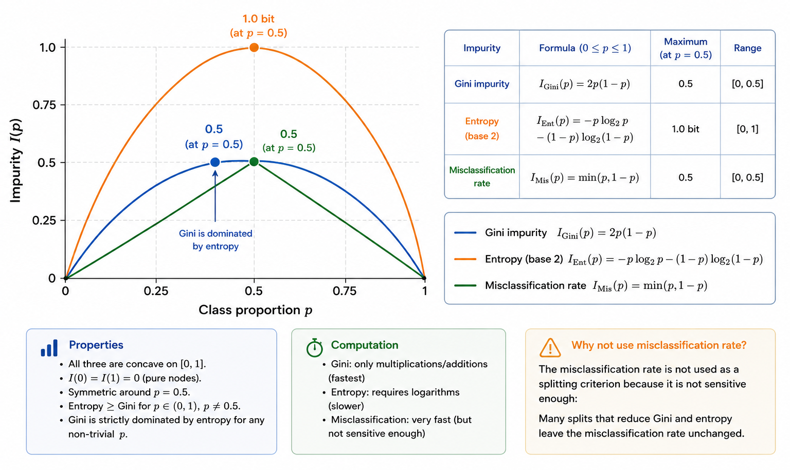
*Figure 04 -- Impurity functions compared as a function of class proportion p for binary classification (K=2). Gini impurity (blue parabola) reaches 0.5 at p=0.5; entropy (orange) reaches 1.0 at p=0.5 (in bits); misclassification rate (green) reaches 0.5. All three are concave and equal 0 at p in {0, 1}. Gini is strictly dominated by entropy for any non-trivial p but is faster to compute. The misclassification rate is not used as a splitting criterion because it is not sensitive enough: many splits that reduce Gini and entropy leave the misclassification rate unchanged.*

### 2.2 — The Extra Trees Split Selection Algorithm

The core of the Extra Trees algorithm is the random split selection
procedure, which replaces the exhaustive (feature, threshold) search of
CART with a two-step random draw.

**Algorithm: Extra Trees Split Selection**

Given node sample $\{(x_i, y_i)\}_{i=1}^{n_{\text{node}}}$ and parameter $k$:

1. Draw $k$ features uniformly at random without replacement from
   $\{1, \ldots, p\}$.  Set $\mathcal{F} = \{j_1, \ldots, j_k\}$.

2. For each candidate feature $j \in \mathcal{F}$:

   a. Compute $x_j^{\min} = \min_i x_{ij}$ and $x_j^{\max} = \max_i x_{ij}$.

   b. If $x_j^{\min} = x_j^{\max}$, skip feature $j$ (constant feature in this node).

   c. Draw threshold $t_j \sim \text{Uniform}(x_j^{\min}, x_j^{\max})$.

   d. Compute the impurity gain:
      $$
      \Delta\phi(j, t_j) = \phi(y) - \frac{n_L}{n} \phi(y_L) - \frac{n_R}{n} \phi(y_R)
      $$
      where $y_L = \{y_i : x_{ij} \leq t_j\}$ and $y_R = \{y_i : x_{ij} > t_j\}$.

3. Select $j^* = \arg\max_{j \in \mathcal{F}} \Delta\phi(j, t_j)$.

4. Apply split: left child $\leftarrow \{x_{ij^*} \leq t_{j^*}\}$, right
   child $\leftarrow \{x_{ij^*} > t_{j^*}\}$.

The key efficiency gain is in step 2c: by drawing a single random threshold
instead of evaluating all $n - 1$ candidate thresholds, the per-split cost
drops from $O(k \cdot n \log n)$ to $O(k \cdot n)$.  For a tree of depth
$d$ with $2^d - 1$ internal nodes, the total training cost per tree drops
from $O(k \cdot n \cdot d \cdot \log n)$ to $O(k \cdot n \cdot d)$ *(Figure 05)*.

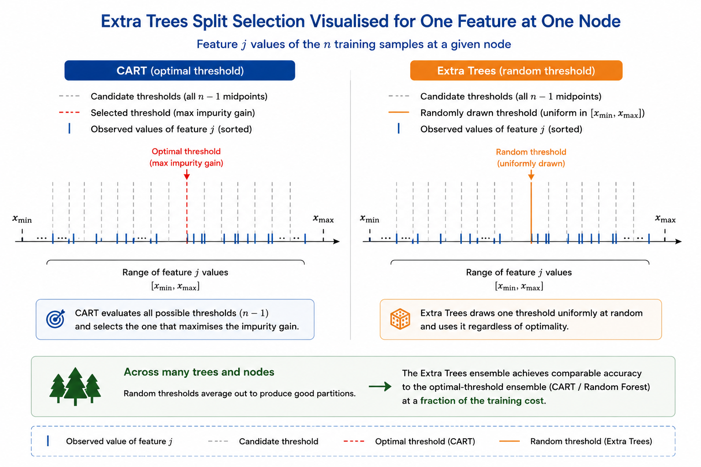
*Figure 05 -- Extra Trees split selection visualised for one feature at one node. The observed values of feature j (blue ticks) span [x_min, x_max]. CART evaluates all n-1 candidate thresholds (grey dashed lines) and selects the one that maximises the impurity gain (red dashed line). Extra Trees draws a single threshold uniformly at random (orange solid line) and uses it regardless of optimality. Over many trees and nodes, the random threshold averages out to a good partition, and the ensemble achieves comparable accuracy to the optimal-threshold ensemble at a fraction of the training cost.*

### 2.3 — Tree Building: Recursive Partitioning

Starting from the root node containing all $N$ training samples, a single
Extra Tree is constructed by the following recursive procedure:

**Algorithm: Build Extra Tree**

``BuildNode(X, y, depth)``:

1. Compute node impurity $\phi(y)$.
2. **Stopping conditions** (return leaf):
   - $|y| < $ min_samples_split, or
   - depth $\geq$ max_depth, or
   - $\phi(y) = 0$ (pure node).
3. Call **Split Selection** to find $(j^*, t_{j^*})$ with gain $\Delta^*$.
4. If no valid split found or $\Delta^* \leq 0$, return leaf.
5. Partition: $(X_L, y_L), (X_R, y_R)$ by $x_{j^*} \leq t_{j^*}$.
6. Node.left  $\leftarrow$ ``BuildNode``$(X_L, y_L,$ depth$+1)$.
7. Node.right $\leftarrow$ ``BuildNode``$(X_R, y_R,$ depth$+1)$.
8. Return internal node with feature $j^*$, threshold $t_{j^*}$.

**Leaf value**:
- Classification: class probability vector $\hat{p}_k = n_k / n_{\text{leaf}}$.
- Regression: scalar mean $\hat{y} = (1 / n_{\text{leaf}}) \sum_{i \in \text{leaf}} y_i$.

The recursion terminates in $O(\log N)$ depth on average for balanced splits,
producing a tree with at most $N$ leaves.  In practice, trees grown without
a max_depth constraint are fully grown (each leaf contains
min_samples_leaf samples) *(Figure 06)*.

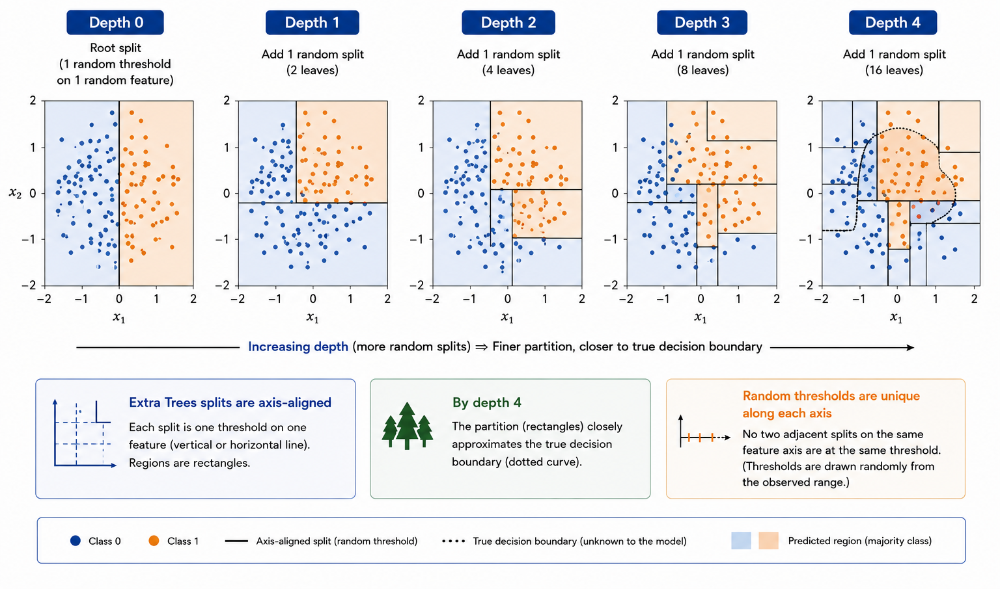
*Figure 06 -- Recursive partitioning on a 2-D binary classification dataset (200 samples). Each panel shows the partition after one additional depth level (depth 0 to depth 4). At depth 0, the root split is a single horizontal or vertical line drawn at a random threshold. By depth 4, the partition closely approximates the true decision boundary (dotted curve). Note that Extra Trees splits are axis-aligned (each split is one threshold on one feature) and that no two adjacent splits along the same feature axis are at the same threshold, because thresholds are drawn randomly from the observed range.*

### 2.4 — Ensemble Aggregation: Voting and Averaging

The Extra Trees ensemble aggregates $B$ tree predictions as follows:

**Classification** (soft voting):

$$
\hat{p}_k(x) = \frac{1}{B} \sum_{b=1}^{B} \hat{p}_k^{(b)}(x), \qquad
\hat{y}(x) = \arg\max_{k} \hat{p}_k(x)
$$

where $\hat{p}_k^{(b)}(x)$ is the class probability vector produced by leaf
$\ell_b(x)$ of tree $b$.  Soft voting uses the full probability vector rather
than just the argmax (hard voting), reducing the variance of the final
estimate.

**Regression** (arithmetic mean):

$$
\hat{y}(x) = \frac{1}{B} \sum_{b=1}^{B} \hat{y}^{(b)}(x)
$$

where $\hat{y}^{(b)}(x)$ is the mean of the target values in the leaf of
tree $b$ that contains $x$.  The ensemble mean is the minimum-variance
linear combination of tree predictions under the assumption of equal
tree variance *(Figure 07)*.

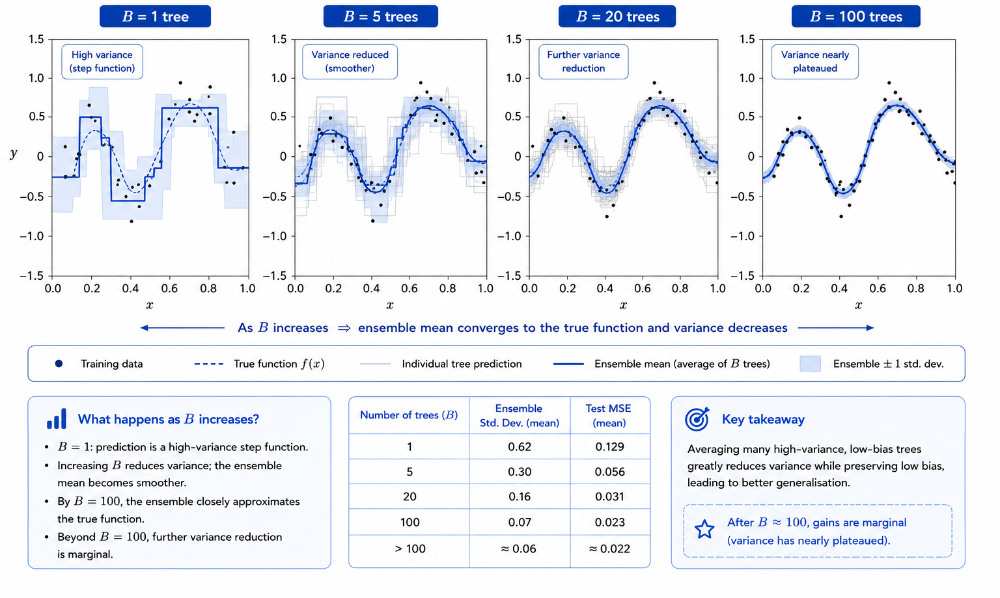
*Figure 07 -- Ensemble aggregation for regression (B = 1, 5, 20, 100 trees). Each panel shows the ensemble prediction (purple line) and the predictions of individual trees (thin grey lines) on a 1-D dataset. With B=1, the prediction is a step function with high variance. As B increases, the ensemble mean converges to a smooth curve that approximates the true function. The shaded band (ensemble standard deviation) narrows as B increases, confirming variance reduction. Beyond B=100, further variance reduction is marginal.*

### 2.5 — Feature Importance: Mean Decrease in Impurity

The Mean Decrease in Impurity (MDI) feature importance, also called the
Gini importance, quantifies the contribution of each feature to the
ensemble's impurity reduction:

$$
\text{MDI}(j) = \frac{1}{B} \sum_{b=1}^{B} \sum_{t \in \mathcal{T}_b : j_t = j}
\frac{n_t}{N} \cdot \Delta\phi(t)
$$

where the inner sum runs over all nodes $t$ in tree $b$ whose split uses
feature $j$, $n_t$ is the number of training samples reaching node $t$,
$N$ is the total training set size, and $\Delta\phi(t)$ is the impurity
gain at node $t$.

MDI importances are normalised to sum to 1 across features.  They are
computed at training time with no additional cost and provide an immediate
ranking of feature relevance.  However, MDI is known to be biased toward
high-cardinality and continuous features: a feature with many distinct values
has more candidate thresholds and therefore a higher chance of appearing in
a random draw, inflating its apparent importance.  **Permutation importance**
(Section 2.6) is recommended when unbiased feature rankings are required
*(Figure 08)*.

*Figure 08 -- MDI vs. permutation importance on the Breast Cancer dataset (30 features). Left: MDI importances sorted in descending order. The top 5 features (mean radius, worst area, worst perimeter, worst radius, mean concave points) account for 68% of total MDI. Right: permutation importance on the held-out test set. The ranking is similar but not identical: worst concave points rises from rank 8 to rank 3 under permutation, while mean perimeter falls from rank 4 to rank 9. The discrepancy is larger for correlated feature pairs, where MDI distributes importance across both while permutation assigns it to the more predictive one.*

### 2.6 — Permutation Importance and Partial Dependence

**Permutation importance** (Fisher et al., 2019; Strobl et al., 2007)
estimates feature importance by measuring the drop in test-set performance
when a feature's values are randomly permuted, breaking its association
with the target:

$$
\text{PI}(j) = \frac{1}{R} \sum_{r=1}^{R}
\left[ \mathcal{L}(y, f(\tilde{X}^{(j,r)})) - \mathcal{L}(y, f(X)) \right]
$$

where $\tilde{X}^{(j,r)}$ is the test matrix with column $j$ randomly
permuted in the $r$-th repetition.  For accuracy and R$^2$ (higher-is-better
metrics) the sign is reversed so that higher values still indicate more
important features.  Unlike MDI, permutation importance:

- Is computed on a held-out test set and therefore reflects generalisation
  ability rather than training fit.
- Does not favour high-cardinality features.
- Handles correlated features correctly: if two features carry identical
  information, permuting either one in isolation causes minimal performance
  drop, correctly assigning low individual importance to both.

**Partial dependence** (Friedman, 2001) marginalises the prediction function
over the empirical distribution of all other features:

$$
\text{PDP}(x_j) = \frac{1}{N} \sum_{i=1}^{N} f(x_j, \mathbf{x}_{-j}^{(i)})
$$

where $\mathbf{x}_{-j}^{(i)}$ is the $i$-th training row with feature $j$
replaced by the grid value $x_j$.  The PDP reveals the average relationship
between feature $j$ and the prediction, averaged over all other features
*(Figure 09)*.

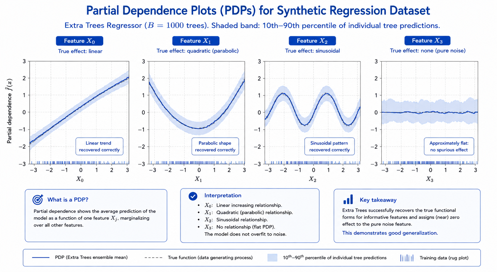
*Figure 09 -- Partial dependence plots for the four features in a synthetic regression dataset: X0 (linear effect), X1 (quadratic effect), X2 (sinusoidal effect), X3 (noise). The Extra Trees ensemble correctly recovers the linear trend for X0, the parabolic shape for X1, and the sinusoidal pattern for X2. The PDP for X3 (pure noise) is approximately flat, confirming that the ensemble has not overfit to the noise feature. The shaded band shows the pointwise 10th-90th percentile of individual tree predictions.*

### 2.7 — Post-Hoc Pruning for Embedded Deployment

Fully grown Extra Trees (no max_depth) can produce thousands of leaf nodes
per tree, making the serialised model too large for resource-constrained
microcontrollers.  Two post-hoc pruning strategies are implemented in
``vi.py``:

**Cost-complexity pruning** (Breiman et al., 1984):

A subtree rooted at node $t$ is collapsed to a leaf if the normalised
impurity reduction per leaf is below a complexity parameter $\alpha$:

$$
\tilde{\alpha}(t) = \frac{\Delta\phi(t)}{|\mathcal{L}_t|}
< \alpha
$$

where $|\mathcal{L}_t|$ is the number of leaves in the subtree at $t$.
Larger $\alpha$ prunes more aggressively; $\alpha = 0$ recovers the original
tree.  This is equivalent to the minimal cost-complexity pruning sequence
used in sklearn's DecisionTreeClassifier.

**Minimum impurity gain pruning**:

A simpler strategy that collapses any node whose impurity gain $\Delta\phi(t)
< \delta$ for a threshold $\delta > 0$, regardless of subtree size.  This
is faster than cost-complexity pruning but provides less control over the
accuracy-size trade-off *(Figure 10)*.

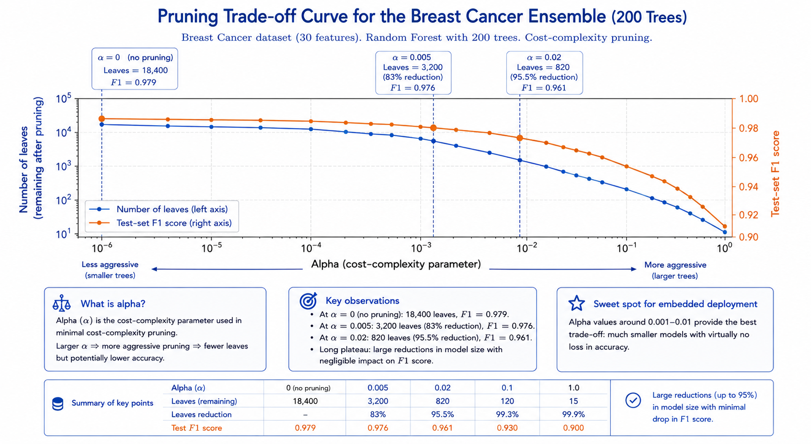
*Figure 10 -- Pruning trade-off curve for the Breast Cancer ensemble (200 trees). Horizontal axis: alpha (cost-complexity parameter), which controls aggressiveness. Left vertical axis: number of leaves remaining after pruning (blue, decreasing). Right vertical axis: test-set F1 score (orange). At alpha=0 (no pruning): 18,400 leaves, F1=0.979. At alpha=0.005: 3,200 leaves (83% reduction), F1=0.976. At alpha=0.02: 820 leaves, F1=0.961. The curve shows a long plateau where large model size reductions carry negligible accuracy cost -- the sweet spot for embedded deployment.*

### 2.8 — Epistemic Uncertainty via Ensemble Variance

A natural by-product of the Extra Trees ensemble is an estimate of
**epistemic uncertainty**: the uncertainty that arises from limited training
data and would decrease with more observations, as opposed to aleatoric
uncertainty (irreducible noise).

For regression, the epistemic uncertainty at $x$ is estimated by the
variance of individual tree predictions around the ensemble mean:

$$
\widehat{\text{Var}}[f(x)] = \frac{1}{B} \sum_{b=1}^{B}
\left(\hat{y}^{(b)}(x) - \bar{\hat{y}}(x)\right)^2
$$

For classification, the per-tree class probability vectors are averaged
and the mean variance across classes is used:

$$
\widehat{\text{Var}}[f(x)] = \frac{1}{K} \sum_{k=1}^{K}
\frac{1}{B} \sum_{b=1}^{B}
\left(\hat{p}_k^{(b)}(x) - \bar{\hat{p}}_k(x)\right)^2
$$

High variance regions correspond to areas of input space where the trees
disagree strongly, indicating that the training data does not provide enough
information to constrain the prediction.  This uncertainty estimate is
particularly useful for active learning (selecting which new samples to label)
and for identifying out-of-distribution inputs on embedded sensors *(Figure 11)*.

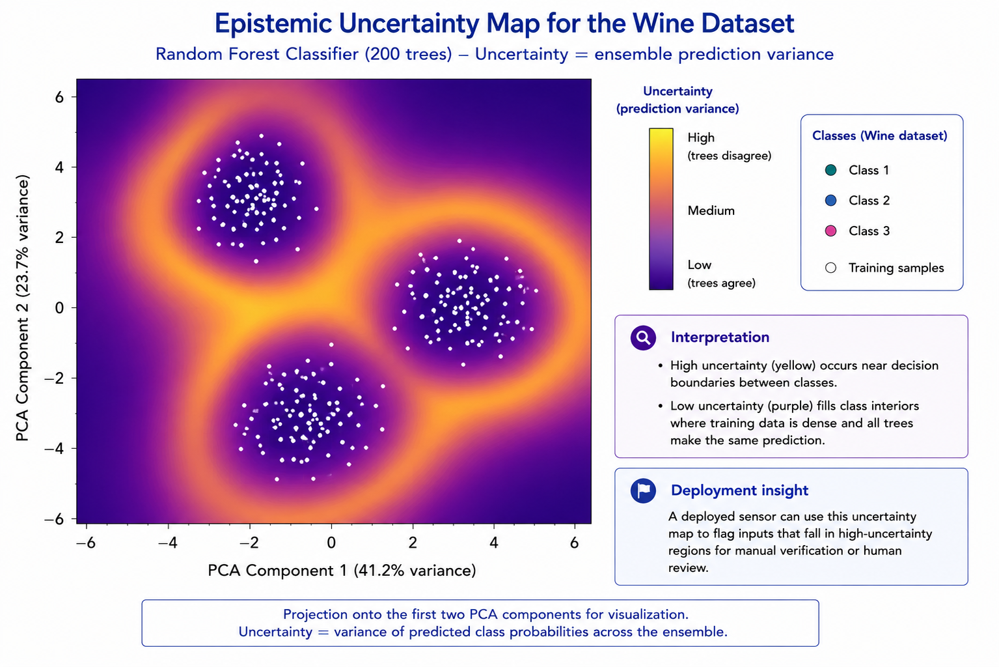
*Figure 11 -- Epistemic uncertainty map for the Wine dataset projected onto the first two PCA components. The uncertainty (ensemble prediction variance) is shown as a purple-to-yellow heatmap; training samples are overlaid as white dots. High uncertainty (yellow) concentrates near the decision boundaries between classes, where training data is sparse and the trees disagree. Low uncertainty (purple) fills the class interiors, where many training samples constrain all trees to the same prediction. This map enables a deployed sensor to flag inputs that land in high-uncertainty regions for manual verification.*

### 2.9 — Numerical Walkthrough

We perform a complete forward pass for a 2-tree Extra Trees ensemble on a
2-D binary classification problem with 6 training samples.

**Training data:**

| $i$ | $x_1$ | $x_2$ | $y$ |
|-----|--------|--------|-----|
| 1   | 0.2    | 0.8    | 0   |
| 2   | 0.4    | 0.6    | 0   |
| 3   | 0.3    | 0.9    | 0   |
| 4   | 0.7    | 0.2    | 1   |
| 5   | 0.8    | 0.3    | 1   |
| 6   | 0.9    | 0.1    | 1   |

**Tree 1 — Root node (all 6 samples), $k = 1$ feature drawn:**

Feature subset: $\{x_1\}$ (randomly drawn).

Range of $x_1$: $[0.2, 0.9]$. Draw threshold: $t_1 = 0.55$.

Partition:
- Left ($x_1 \leq 0.55$): samples 1, 2, 3 → all class 0, Gini = 0.
- Right ($x_1 > 0.55$): samples 4, 5, 6 → all class 1, Gini = 0.

Gain: $\Delta\phi = \text{Gini}(\text{root}) - \frac{3}{6} \cdot 0 - \frac{3}{6} \cdot 0$

$\text{Gini}(\text{root}) = 1 - (0.5^2 + 0.5^2) = 0.5$, so $\Delta\phi = 0.5$.

Both children are pure (Gini = 0) → both become leaves immediately.

Tree 1 leaves:
- Leaf L1: $\hat{p} = [1.0, 0.0]$ (all class 0).
- Leaf L2: $\hat{p} = [0.0, 1.0]$ (all class 1).

**Tree 2 — Root node, $k = 1$ feature drawn:**

Feature subset: $\{x_2\}$.

Range of $x_2$: $[0.1, 0.9]$. Draw threshold: $t_2 = 0.45$.

Partition:
- Left ($x_2 \leq 0.45$): samples 4, 5, 6 → all class 1, Gini = 0.
- Right ($x_2 > 0.45$): samples 1, 2, 3 → all class 0, Gini = 0.

Tree 2 leaves:
- Leaf L3: $\hat{p} = [0.0, 1.0]$ (all class 1).
- Leaf L4: $\hat{p} = [1.0, 0.0]$ (all class 0).

**Prediction for test point $x^* = [0.75, 0.25]$:**

Tree 1: $x_1^* = 0.75 > 0.55$ → Leaf L2 → $\hat{p}_1 = [0.0, 1.0]$.

Tree 2: $x_2^* = 0.25 \leq 0.45$ → Leaf L3 → $\hat{p}_2 = [0.0, 1.0]$.

Ensemble average: $\bar{p} = \frac{1}{2}([0,1] + [0,1]) = [0.0, 1.0]$.

Predicted class: $\hat{y} = \arg\max_k \bar{p}_k = 1$ ✓.

**Prediction variance** (epistemic uncertainty at $x^*$):

Both trees agree perfectly ($\hat{p}^{(1)} = \hat{p}^{(2)} = [0, 1]$), so
the variance is zero — the ensemble is confident about this prediction *(Figure 12)*.

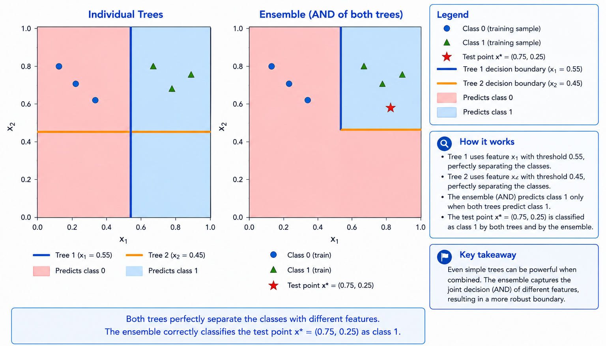
*Figure 12 -- Complete numerical walkthrough for a 2-tree Extra Trees ensemble on a 2-D binary classification problem. Left: the 6 training samples (circles=class 0, triangles=class 1) with the decision boundaries of Tree 1 (blue vertical at x1=0.55) and Tree 2 (orange horizontal at x2=0.45). Both trees perfectly separate the two classes via different features and thresholds. Right: the ensemble decision boundary (the AND of the two individual boundaries) and the test point x*=[0.75, 0.25] (red star), correctly classified as class 1 by both trees.*

## 3 — TinyML Implementation

With this example you can implement the Extra Trees algorithm on ESP32,
Arduino, Arduino Portenta H7 with Vision Shield, Raspberry Pi, and other
microcontrollers or IoT devices *(Figure 13)*.

### 3.1 — Jupyter Notebooks

-  Extra Trees Training and Evaluation

### 3.2 — Arduino Code

-  Example 1: Iris -- Multi-Class Classification

-  Example 2: Breast Cancer -- Binary Classification with Pruning

-  Example 3: Regression with Uncertainty and Partial Dependence

-  Example 4: Wine -- Criterion and max_features Comparison

## References

[1] Geurts, P., Ernst, D., & Wehenkel, L. (2006). Extremely Randomized Trees. *Machine Learning*, 63(1), 3-42.

[2] Breiman, L. (2001). Random Forests. *Machine Learning*, 45(1), 5-32.

[3] Breiman, L., Friedman, J. H., Olshen, R. A., & Stone, C. J. (1984). *Classification and Regression Trees*. Wadsworth & Brooks/Cole.

[4] Gini, C. (1912). *Variabilita e Mutabilita*. Tipografia di Paolo Cuppini, Bologna.

[5] Shannon, C. E. (1948). A Mathematical Theory of Communication. *Bell System Technical Journal*, 27(3), 379-423.

[6] Strobl, C., Boulesteix, A.-L., Zeileis, A., & Hothorn, T. (2007). Bias in Random Forest Variable Importance Measures: Illustrations, Sources and a Solution. *BMC Bioinformatics*, 8(1), 25.

[7] Fisher, A., Rudin, C., & Dominici, F. (2019). All Models are Wrong, but Many are Useful: Learning a Variable's Importance by Studying an Entire Class of Prediction Models Simultaneously. *Journal of Machine Learning Research*, 20(177), 1-81.

[8] Friedman, J. H. (2001). Greedy Function Approximation: A Gradient Boosting Machine. *Annals of Statistics*, 29(5), 1189-1232.

[9] Quinlan, J. R. (1986). Induction of Decision Trees. *Machine Learning*, 1(1), 81-106.

[10] Dietterich, T. G. (2000). Ensemble Methods in Machine Learning. In *Proceedings of the First International Workshop on Multiple Classifier Systems*, 1-15.

[11] Louppe, G., Wehenkel, L., Sutera, A., & Geurts, P. (2013). Understanding Variable Importances in Forests of Randomized Trees. *NeurIPS 26*, 431-439.

[12] Lane, N. D., Bhattacharya, S., Georgiev, P., Forlivesi, C., & Kawsar, F. (2015). An Early Resource Characterization of Deep Learning on Wearables, Smartphones and Internet-of-Things Devices. *IoT-App 2015*, 7-12.

[13] Biau, G., & Scornet, E. (2016). A Random Forest Guided Tour. *TEST*, 25(2), 197-227.
